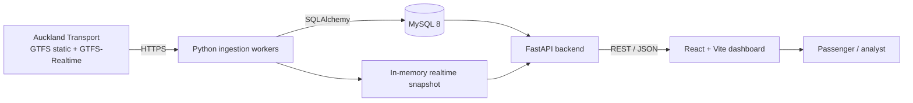

# Architecture

## System context



## Components

| Component | Technology | Responsibility |
| --- | --- | --- |
| `backend/app/api` | Python 3.12, FastAPI, Pydantic | REST API, validation, OpenAPI docs |
| `backend/app/gtfs` | `zipfile`, `csv`, `httpx` | Parse and transactionally load the AT static bundle, including `shapes.txt` geometry |
| `backend/app/cli/gtfs.py` | argparse, Alembic | `migrate`, `check-db`, `load`, `status` commands |
| `backend/app/models` | SQLAlchemy 2 ORM | GTFS static tables keyed by `feed_id` |
| `backend/migrations` | Alembic | Versioned MySQL schema |
| `backend/app/ingestion` | `httpx`, threading | Aggregated AT client, decoder, in-memory snapshot and 30 s poller |
| `backend/app/collector` (Phase 4+) | SQLAlchemy | Persist derived delay observations, enforce retention |
| `backend/app/analytics` (Phase 5+) | SQL / aggregations | Punctuality, route ranking, heatmaps, trends |
| Database | MySQL 8 (local install; Docker Compose optional; RDS later) | Static network, observations, aggregates |
| `frontend` | React 18, TypeScript, Vite, TanStack Query, Leaflet | Static network explorer drawing per-shape GTFS geometry (live vehicles in Phase 3, analytics in Phase 5) |
| CI | GitHub Actions | Backend lint/tests and frontend typecheck/tests/build |

## Data flow

1. **Static load** (Phase 1): download the AT GTFS zip, validate it, load routes/stops/
   trips/stop_times/shapes into MySQL with a feed version marker. Runs on demand, then
   on a schedule.
2. **Realtime poll** (Phase 2): one **aggregated** AT call every 30 s returns vehicle
   positions, trip updates and service alerts. The response is decoded into a typed
   snapshot held in memory (raw payloads are never persisted). The API joins it with
   MySQL route labels and overlays live vehicle markers on the map.
3. **Passenger reads** (Phase 3): the browser calls the API for stop arrivals, ETAs and
   delay status; the API joins the realtime snapshot with the static schedule.
4. **Observation collection** (Phase 4): each poll writes compact derived delay records.
   Data quality checks reject impossible values and duplicates.
5. **Analytics** (Phase 5): scheduled aggregation produces daily/hourly reliability
   metrics; the dashboard reads only aggregates, not raw observations.

## Key decisions

| Decision | Rationale |
| --- | --- |
| UTC in storage, `Pacific/Auckland` in UI | Correct handling of NZST/NZDT and GTFS times past midnight |
| Derived observations only | Compliance, small storage footprint, fast analytics queries |
| PyMySQL driver instead of `mysqlclient` | Pure Python, works on Windows without a C toolchain |
| In-memory snapshot for live state | Live data is ephemeral; the database holds history, not current positions |
| Leaflet + OpenStreetMap | No paid token or API key needed for the MVP |
| Server-side API key | The browser never sees the AT subscription key |
| Full snapshots, no diffing | The AT feed does not support incremental updates |
| Configurable endpoint URLs | Legacy and Compat API paths differ per subscription |
| Data-sufficiency labels | Reliability claims require weeks of observations, not minutes |
| Feed-version staging | A new GTFS bundle is loaded under a new `feed_id` and activated in one transaction, so readers never see a half-imported network |
| BOM and nested-folder tolerant parsing | Real GTFS bundles differ in encoding and archive layout |
| GTFS times stored as both raw string and seconds | Supports scheduled times past `24:00:00` without losing the original value |
| Geo search uses a bounding box | Adequate for "stops near me" at city scale; a spatial index can replace it later |
| No database-level FKs between child tables | Keeps bulk inserts fast; referential integrity is enforced by the loader transaction |
| One polyline per `shape_id`, never one per route | A route has many directions and branches (route 70 has 5 shapes); merging their stops produces meaningless straight lines across the map |
| `stop_times` fallback labelled `approximate` | When `shapes.txt` is missing, trips are grouped by their exact ordered stop sequence, but the UI must state that these are not road geometry |
| Shape lookups join `trips` instead of an `IN (subquery)` | Avoids scanning the ~1M-row `stop_times` table; route 70 geometry dropped from 4.2 s to 0.4 s |
| One aggregated realtime call, not three separate feeds | 30 s polling stays at 20,160 calls/week (58% of the 35,000 quota); three feeds would be 60,480/week |
| Realtime state only in memory | Feed frames expire every 30 s; writing them to MySQL would add load without analytical value. History begins in Phase 4 with derived observations |
| Rolling 7-day call budget with reserve and backoff | Protects the weekly quota during retries/outages; CI and unit tests never use the live subscription key |
| Static route labels are a best-effort join | A MySQL outage must not take down live vehicle positions, so realtime endpoints degrade to unlabelled markers |
| Bus-only map, filtered server-side | The product focuses on buses; the browser never downloads train/ferry positions it will not draw. Vehicles whose mode cannot be confirmed are excluded |
| Bus glyphs instead of dots | A small SVG bus rotated to the reported bearing is recognisable at a glance and conveys direction; icons are cached per 15-degree bucket |
| Bounds follow the selected shape | Choosing a route must frame that route automatically, with `invalidateSize` before fitting and a manual `Fit to view` escape hatch |
| A pattern scopes its vehicles | `shape_id` -> `trips.trip_id` -> live vehicle `trip_id`. Outbound and inbound buses must not be mixed when one direction is selected; a failed static lookup degrades to unfiltered buses rather than an empty map |

## Local topology (Phase 0-5)

```text
localhost:3306  MySQL 8 (local install; container optional)
localhost:8000  FastAPI  (uvicorn --reload)
localhost:5173  Vite dev server (proxies /api to :8000)
```

Phase 1 runs entirely against the local MySQL server. Phase 0-5 unit and API tests use
an in-memory/file SQLite database so they never require MySQL credentials; the opt-in
`integration` test verifies the real MySQL schema.

## Target AWS topology (Phase 7, post-MVP)

```text
Route 53 / CloudFront -> S3 (React build)
                      -> ALB -> ECS Fargate (FastAPI + workers)
                                  -> RDS MySQL (Multi-AZ optional)
                                  -> Secrets Manager (AT API key)
CloudWatch (logs, metrics, alarms), ECR (images), IaC (CDK or Terraform)
```
