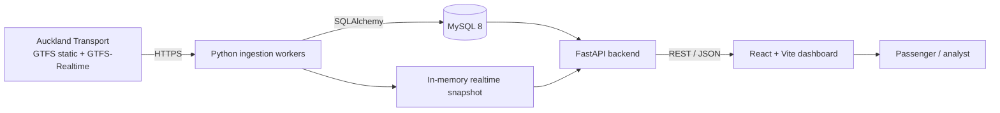

# Architecture

## System context



## Components

| Component | Technology | Responsibility |
| --- | --- | --- |
| `backend/app/api` | Python 3.12, FastAPI, Pydantic | REST API, validation, OpenAPI docs, stop arrivals (ETA) |
| `backend/app/gtfs` | `zipfile`, `csv`, `httpx` | Parse and transactionally load the AT static bundle, including `shapes.txt` geometry |
| `backend/app/cli/gtfs.py` | argparse, Alembic | `migrate`, `check-db`, `load`, `status` commands |
| `backend/app/models` | SQLAlchemy 2 ORM | GTFS static tables keyed by `feed_id` |
| `backend/migrations` | Alembic | Versioned MySQL schema |
| `backend/app/ingestion` | `httpx`, threading | Aggregated AT client, decoder, in-memory snapshot and 30 s poller |
| `backend/app/reports` | `httpx`, `openpyxl`, SQLAlchemy | Download and parse official AT XLSX reports, normalize rows, record data-quality issues |
| `backend/app/analytics` | SQL / aggregations | Service layer for route ranking, heatmaps, trends, patronage vs performance and network metrics |
| Database | MySQL 8 (local install; Docker Compose optional; RDS later) | Static network, official report tables, analytics inputs |
| `frontend` | React 18, TypeScript, Vite, TanStack Query, Leaflet, React Router | Routed app shell: live bus map on `/`, analytics dashboard on `/analytics` |
| CI | GitHub Actions | Backend lint/tests and frontend typecheck/tests/build |

## Data flow

1. **Static load** (Phase 1): download the AT GTFS zip, validate it, load routes/stops/
   trips/stop_times/shapes into MySQL with a feed version marker. Runs on demand, then
   on a schedule.
2. **Realtime poll** (Phase 2): one **aggregated** AT call every 30 s returns vehicle
   positions, trip updates and service alerts. The response is decoded into a typed
   snapshot held in memory (raw payloads are never persisted). The API joins it with
   MySQL route labels and overlays live vehicle markers on the map.
3. **Passenger reads** (Phase 3): the browser calls `/stops/{id}/arrivals`; the API joins
   MySQL `stop_times`/`trips`/`routes` (scheduled times) with the realtime snapshot
   (delays) and returns ETAs plus delay status. Service alerts are filtered to bus routes.
4. **Official report ingestion** (Phase 4): AT's published XLSX workbooks are downloaded
   on demand, parsed with workbook-specific profiles, and normalized into source-tagged
   MySQL tables. Data-quality checks record missing columns, unmapped routes and
   impossible metric values.
5. **Analytics** (Phase 5): the `/analytics` page calls the analytics API. The service
   layer de-duplicates official report families, hides school routes by default, ranks
   routes, builds trends/heatmaps/scatter data, and derives network metrics from static
   GTFS. Official indicators and locally computed metrics are labelled separately.

## Key decisions

| Decision | Rationale |
| --- | --- |
| UTC in storage, `Pacific/Auckland` in UI | Correct handling of NZST/NZDT and GTFS times past midnight |
| Official published reports for MVP history | Years of trusted AT-published indicators are available immediately; no always-on local collector, no extra API quota and no raw realtime persistence |
| PyMySQL driver instead of `mysqlclient` | Pure Python, works on Windows without a C toolchain |
| In-memory snapshot for live state | Live data is ephemeral; the database holds history, not current positions |
| Leaflet + OpenStreetMap | No paid token or API key needed for the MVP |
| Server-side API key | The browser never sees the AT subscription key |
| Full snapshots, no diffing | The AT feed does not support incremental updates |
| Configurable endpoint URLs | Legacy and Compat API paths differ per subscription |
| Official vs local metrics stay separate | AT punctuality/reliability definitions are displayed verbatim; GTFS-derived frequency/corridor metrics are labelled as locally computed |
| Feed-version staging | A new GTFS bundle is loaded under a new `feed_id` and activated in one transaction, so readers never see a half-imported network |
| BOM and nested-folder tolerant parsing | Real GTFS bundles differ in encoding and archive layout |
| GTFS times stored as both raw string and seconds | Supports scheduled times past `24:00:00` without losing the original value |
| Geo search uses a bounding box | Adequate for "stops near me" at city scale; a spatial index can replace it later |
| No database-level FKs between child tables | Keeps bulk inserts fast; referential integrity is enforced by the loader transaction |
| One polyline per `shape_id`, never one per route | A route has many directions and branches (route 70 has 5 shapes); merging their stops produces meaningless straight lines across the map |
| `stop_times` fallback labelled `approximate` | When `shapes.txt` is missing, trips are grouped by their exact ordered stop sequence, but the UI must state that these are not road geometry |
| Shape lookups join `trips` instead of an `IN (subquery)` | Avoids scanning the ~1M-row `stop_times` table; route 70 geometry dropped from 4.2 s to 0.4 s |
| One aggregated realtime call, not three separate feeds | 30 s polling stays at 20,160 calls/week (58% of the 35,000 quota); three feeds would be 60,480/week |
| Realtime state only in memory | Feed frames expire every 30 s; writing them to MySQL would add load without analytical value. Phase 4 history comes from AT's published reports instead |
| Rolling 7-day call budget with reserve and backoff | Protects the weekly quota during retries/outages; CI and unit tests never use the live subscription key |
| Static route labels are a best-effort join | A MySQL outage must not take down live vehicle positions, so realtime endpoints degrade to unlabelled markers |
| Bus-only map, filtered server-side | The product focuses on buses; the browser never downloads train/ferry positions it will not draw. Vehicles whose mode cannot be confirmed are excluded |
| Bus glyphs instead of dots | A small SVG bus rotated to the reported bearing is recognisable at a glance and conveys direction; icons are cached per 15-degree bucket |
| Bounds follow the selected shape | Choosing a route must frame that route automatically, with `invalidateSize` before fitting and a manual `Fit to view` escape hatch |
| A pattern scopes its vehicles | `shape_id` -> `trips.trip_id` -> live vehicle `trip_id`. Outbound and inbound buses must not be mixed when one direction is selected; a failed static lookup degrades to unfiltered buses rather than an empty map |
| Buses-only product, generic data layer | AT publishes rail and ferry entities too. Importing the full static feed keeps the loader simple and preserves `route_type`, but every user-facing query filters `mode=Bus`; the UI exposes no mode selector |
| Static timetable as base, realtime as overlay | A scheduled arrival is useful even without a live prediction; trip-level or stop-level delays are applied only when a matching `trip_id` exists |
| Stations aggregate their platforms | GTFS stations (`location_type=1`) have no `stop_times` rows; child platforms are resolved and listed in the arrival response |
| Service calendars define "runs today" | `calendar.txt` weekly flags plus `calendar_dates.txt` exceptions are imported and applied to the Auckland service date; inactive service variants no longer create duplicate scheduled rows |
| `tzdata` is a runtime dependency | Windows has no system tz database, so `zoneinfo` needs `tzdata` to resolve `Pacific/Auckland` (NZST/NZDT) |
| Viewport comes only from the selected shape | While geometry loads, falling back to all live vehicle positions framed the whole city; the map container also stays mounted so Leaflet is not recreated between route selections |
| Arrival boards follow the selected route | The board and stop search are route-scoped by default because that is the product intent; an explicit `Show all buses at this stop` control prevents the filter from being hidden |
| The map row has a bounded height | The 100-route list must scroll inside its own panel; otherwise the flex/grid row grows to thousands of pixels and Leaflet centres the route geometry outside the visible viewport. `FitBounds` also waits for a usable `getSize()` |
| Live map remains the landing page | Users first want to see buses moving; analytics is a separate route so neither page becomes crowded |
| Analytics aggregation lives in a service layer | API endpoints stay thin; de-duplication, school-route filtering and source priority are testable in one place |
| Frontend pages, hooks and chart components are separate | Improves comprehensibility and alterability; a chart change cannot accidentally alter live-map behaviour |
| Lightweight SVG charts instead of a chart framework | The MVP needs a few simple visuals; a smaller dependency surface improves testability and long-term maintenance |
| School routes hidden by default in rankings | Near-zero school-service punctuality would otherwise dominate "worst route" results without useful context |
| Left sidebar navigation | Future modules such as prediction models and network analysis need a scalable navigation surface; the live map remains the landing page |
| Every analytic panel states a business question | `ChartInsight` explains what the chart shows and how to read it, preventing decorative analysis |
| Route-level scatter aggregation | One point per route answers "are busy routes reliable?"; dense route-month points do not |
| Heatmap is an optional diagnostic | Seasonality is useful only for a specific question, so it is collapsed rather than shown as a headline KPI |
| English month controls generated from coverage | Native month inputs expose the OS locale; controlled year/month selects keep all product copy in English |
| Monthly panel time series is a future model input | Official `route_no + month` metrics support seasonality, forecasting and anomaly detection, but route changes and missing months require careful modelling |
| Analytics is split into five decision views | Overview, Ridership, Performance, Relationships and Methodology each answer a different question and reduce mixed semantics |
| Metric metadata is shared by backend and frontend | `METRIC_CATALOG` and `metricDefinitions.ts` keep unit, definition, source family and kind consistent |
| Ridership is never a performance grade | Most-used rankings and route attention rankings are separate views with different sort semantics |
| Route mapping is additive and read-only | Official route numbers map to GTFS `route_id` through `short_name`; neither source is mutated |
| Correlation has explicit validity rules | Spearman correlation is shown only with at least five comparable route averages and is labelled descriptive |

## Local topology (Phase 0-5)

```text
localhost:3306  MySQL 8 (local install; container optional)
localhost:8000  FastAPI  (uvicorn --reload)
localhost:5173  Vite dev server (proxies /api to :8000)
```

Phase 1 runs entirely against the local MySQL server. Phase 0-5 unit and API tests use
an in-memory/file SQLite database so they never require MySQL credentials; the opt-in
`integration` test verifies the real MySQL schema.

## Target AWS topology (Phase 7, post-MVP)

```text
Route 53 / CloudFront -> S3 (React build)
                      -> ALB -> ECS Fargate (FastAPI + workers)
                                  -> RDS MySQL (Multi-AZ optional)
                                  -> Secrets Manager (AT API key)
CloudWatch (logs, metrics, alarms), ECR (images), IaC (CDK or Terraform)
```
